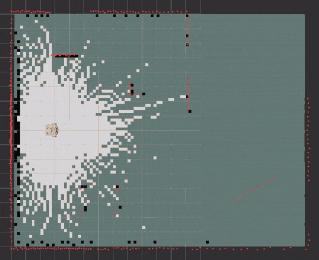

# rover_sim



*The simulated rover drives a loop of a 5 x 4 m room while slam_toolbox builds
the map from its lidar (10x speed).*

URDF model of a small differential-drive rover for ROS 2 Jazzy: two driven
wheels (65 mm, 214.6 mm track) and a rear swivel caster. The 3D printed
chassis has three decks: the motor deck, an electronics deck, and a compute
deck that carries a Raspberry Pi underneath, a front speaker and an RPLIDAR
A1 on top. There is a bay for a battery.

- `urdf/rover.urdf.xacro`: the model. Every dimension and mass is a xacro
  property at the top of the file.
- `meshes/`: STL meshes of the printed parts, used for visuals only.
  Collisions use simple boxes, cylinders and spheres. In Gazebo the wheels
  collide as spheres, so turning matches the wheel odometry.
- `launch/display.launch.py`: robot_state_publisher, joint_state_publisher_gui
  and RViz.
- `launch/gazebo.launch.py`: the rover in Gazebo (Harmonic), driven by
  ros2_control's `diff_drive_controller`, with a simulated RPLIDAR A1 on
  `/scan`.
- `launch/slam.launch.py`: the Gazebo rover plus slam_toolbox, building a
  map in RViz.
- `config/controllers.yaml`: controller settings (wheel size, speed limits).
- `config/slam_toolbox.yaml`: mapping settings.
- `worlds/room.sdf`: a 5 x 4 m room with walls and a few obstacles.

Frames: `base_footprint` (floor) -> `base_link` (on the drive axle) ->
`left_wheel_link`, `right_wheel_link`, `caster_link`, `lidar_link` (the
lidar's scan centre, 22.3 cm above the floor) and `camera_link` (a
placeholder for a future camera).

The caster is modelled as a fixed sphere. Purchased parts (Pi, speaker,
boards, lidar, battery) are drawn as simple boxes and cylinders. Their
masses, the lidar dimensions and the camera position are datasheet values
or estimates for now.

## Build

```sh
cd ~/ros2_ws
colcon build --packages-select rover_sim
source install/setup.bash
```

## View in RViz

```sh
ros2 launch rover_sim display.launch.py
```

Use the joint_state_publisher_gui sliders to spin the wheels.

To check the model without RViz:

```sh
xacro src/rover_sim/urdf/rover.urdf.xacro > /tmp/rover.urdf
check_urdf /tmp/rover.urdf
```

## Drive it in Gazebo

```sh
ros2 launch rover_sim gazebo.launch.py          # add rviz:=true to also open RViz
```

In a second terminal:

```sh
ros2 run teleop_twist_keyboard teleop_twist_keyboard --ros-args \
  -p stamped:=true -r cmd_vel:=/diff_drive_controller/cmd_vel
```

Keep the teleop terminal focused: `i` forward, `,` back, `j`/`l` turn,
`k` stop. Top speed is limited to 0.3 m/s. Odometry is published on
`/diff_drive_controller/odom` and as the `odom -> base_footprint` transform.

Launch arguments: `world:=<file.sdf>`, `gui:=false` (headless),
`x:=`, `y:=`, `yaw:=` (spawn pose).

The simulated lidar matches an RPLIDAR A1M8: 360 samples per turn (1
degree apart), 0.15 to 12 m, 5.5 turns per second and 1 cm of noise. It
publishes `sensor_msgs/LaserScan` on `/scan` in the `lidar_link` frame. With
`rviz:=true` the scan shows as red dots.

## Build a map with SLAM

```sh
ros2 launch rover_sim slam.launch.py
```

This starts Gazebo, slam_toolbox (online async mode) and RViz showing the
map. Drive with teleop as above. The map is grey (unknown) at first; free
space turns white and walls turn black as the lidar sees them. Drive
slowly, and come back to where you started so slam_toolbox can close the
loop.

To save the map, in another terminal:

```sh
mkdir -p ~/maps
ros2 run nav2_map_server map_saver_cli -f ~/maps/room
```

That writes `room.pgm` (the image) and `room.yaml` (its resolution and
origin), the format Nav2 loads.

Launch arguments: `gui:=false` (no Gazebo window), `rviz:=false`,
`world:=<file.sdf>`. With `sim:=false` it starts only slam_toolbox and
RViz, for a real rover that already publishes `/scan`, odometry and the
`odom -> base_footprint` transform. On the real rover, start rplidar_ros
with `frame_id:=lidar_link` so its scans use the same frame.

## License

MIT, see [LICENSE](LICENSE).
